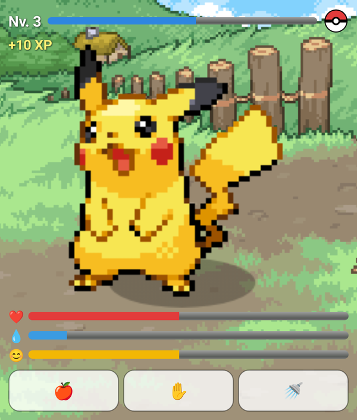
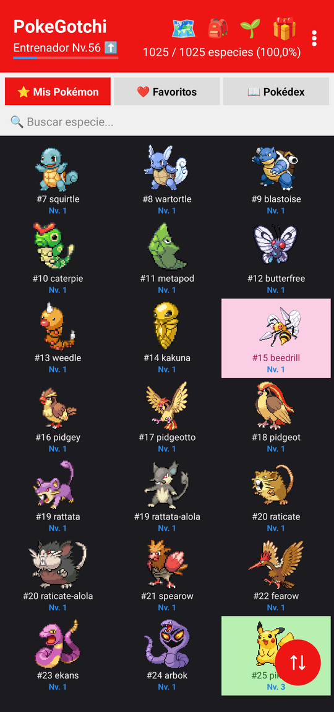
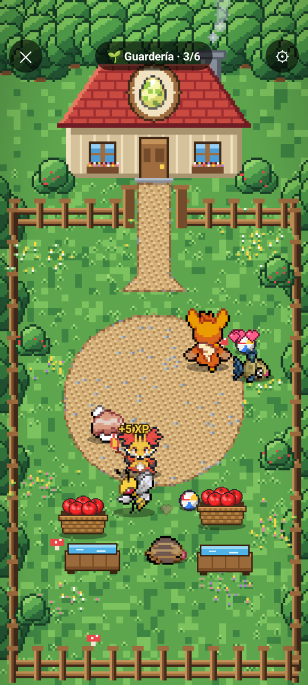
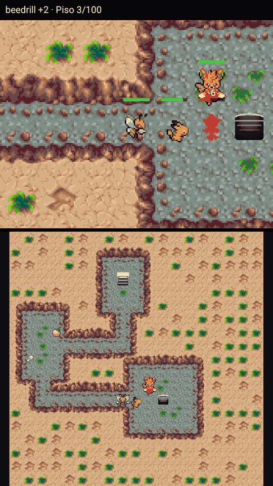
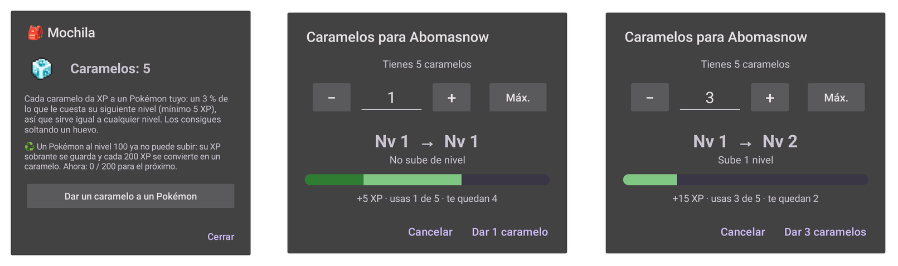

# PokeGotchi

Tamagotchi de Pokémon para Android. Un widget en tu pantalla de inicio con un Pokémon al que
cuidar (dale de comer, acarícialo, báñalo), y detrás una aplicación completa: colecciona los
1025 Pokémon, haz evolucionar a los tuyos, ponlos a entrenar en la **guardería**, mándalos a
explorar la **mazmorra** en equipo y gasta **caramelos** en el que más lo necesite. Todo avanza
también con la app cerrada.

Proyecto personal de fan, sin ánimo de lucro. Los sprites y sonidos de los Pokémon
pertenecen a Nintendo / Game Freak / The Pokémon Company; este repositorio no tiene
afiliación con ellos y no se distribuye con fines comerciales.
Agradecimientos a ErickLostie por los sprites y sonidos y a PokeRogue por algunos sprites faltantes.

<table>
  <tr>
    <td align="center" valign="top"><br><sub>El widget</sub></td>
    <td align="center" valign="top"><br><sub>Tu colección</sub></td>
    <td align="center" valign="top"><br><sub>La guardería</sub></td>
    <td align="center" valign="top"><br><sub>La mazmorra en equipo</sub></td>
  </tr>
</table>

## Características

- **Cuidado en tiempo real:** salud, higiene y felicidad decaen con el tiempo (de forma distinta
  de día y de noche) y se recuperan desde el propio widget. Cada acción da XP y el widget
  muestra el `+N XP` sumándose al nivel.
- **Niveles y experiencia** con las curvas de crecimiento de los juegos originales (rápida,
  media, lenta, errática, fluctuante…), hasta el nivel 100.
- **Evoluciones** por nivel, felicidad, objeto u otras condiciones, con selector de ramas
  (Eevee…) que marca con una Poké Ball las que ya tienes. Si evolucionas a una especie que ya
  tenías, la nueva sustituye a la anterior.
- **Mega Evolución** (Pokémon Nv 50, dura 8 h), **Gigantamax** (Nv 40, dura 4 h) y **Fusiones**
  (Necrozma, Kyurem, Calyrex), además de formas de comportamiento (Wormadam/Gourgeist según
  objeto, Darmanitan modo Zen, Eiscue, Morpeko, Cramorant, Dudunsparce/Maushold, Terapagos…).
- **Pokédex completa** (1025 especies con formas regionales Alola/Galar/Hisui/Paldea), con
  sprites animados en pixel art, gritos de cada Pokémon y buscador, orden y filtros que se
  recuerdan.
- **Regalos a las 9:00 y a las 21:00:** cada reparto te ofrece 5 Pokémon que aún no tienes
  (la forma inicial de cada línea) para que elijas uno. Cada uno puede salir shiny y los
  legendarios llevan borde morado.
- **Huevos:** tu Pokémon puede poner huevos; cuando uno está listo puedes quedarte la cría o
  soltarlo a cambio de un caramelo. También hay shinies, fondos desbloqueables y ciclo día/noche.
- **Nivel de entrenador:** sube con tu colección (cuántos Pokémon tienes, sus niveles,
  evoluciones y shinies) y va desbloqueando mecánicas (ver más abajo).
- **Tutorial de bienvenida** con el Profesor Oak y pistas sobre cada pantalla la primera vez
  que la abres.

## Qué se desbloquea con el nivel de entrenador

| Nivel de entrenador | Novedad |
|---|---|
| 4 | **Mochila y caramelos** |
| 6, 8, 14, 24, 35 y 50 | **Guardería:** 1.ª a 6.ª plaza |
| 10 y 15 | **Compañeros de mazmorra:** 1.º y 2.º |

Los desbloqueos usan el nivel más alto que hayas alcanzado, así que una mecánica abierta no
se vuelve a cerrar aunque tu nivel baje.

## Mazmorra

Se abre desde el icono 🗺️ de la cabecera. Manda a cualquiera de tus Pokémon a explorar hasta
100 pisos generados al azar (con jefes cada 10 pisos): lucha contra enemigos salvajes y recoge
objetos, que son su única fuente de XP (caramelos, vitaminas, bayas y medicinas). Avanza sola
incluso con la app cerrada, mediante un servicio con notificación de estado.

- **Equipo:** el explorador puede llevar compañeros (a partir del nivel de entrenador 10). Van
  en la misma carrera y se reparten el XP; todos los que estén al lado del enemigo atacan, el
  enemigo va a por el más cercano y quien baje del 25 % de vida cede su sitio a un compañero.
  Cuantos más Pokémon entran, más enemigos aparecen.
- **Modo continuo:** encadena carreras con el mismo equipo. Al terminar una carrera (por
  derrota o al completar los 100 pisos) la mazmorra cierra durante un tiempo proporcional a lo
  lejos que se llegó; durante ese cierre puedes cambiar de explorador.
- **Selector** con buscador por nombre, orden (nivel ▼ / ▲ / nombre) y filtros (disponibles,
  shiny). Un Pokémon en la mazmorra no puede estar a la vez en la guardería ni ser el activo del
  widget.

## Guardería

Se abre desde el icono 🌱 (nivel de entrenador 6). Es una escena a pantalla completa donde tus
Pokémon pasean por un jardín:

- **Ganan XP solos:** la mitad por hora que el activo del widget, más un extra por cada
  necesidad que cubren ellos mismos (comen manzanas de la cesta, beben del bebedero, juegan con
  la pelota).
- **Incuban sus huevos:** los que ponen huevos los incuban sin que hagas nada. Los shiny se
  quedan contigo como Pokémon nuevos (con aviso) y el resto se convierte en caramelos.
- **Visitantes:** Pokémon de nivel parecido al de tus huéspedes entran y salen por la puerta
  cada cuarto de hora, solo de ambiente.
- **Juego:** arrastra la cesta, los bebederos y las pelotas; toca tres veces el suelo para
  llamar a todos; de vez en cuando juegan al pilla-pilla.
- Una notificación te avisa cuando un huésped puede evolucionar. Evolucionar ahí dentro lo deja
  en la guardería, sin cambiar tu activo.

## Mochila y caramelos



Soltar un huevo listo da un caramelo, y los huevos que incuba la guardería también acaban
así (salvo los shiny). Cada caramelo da el 3 % de lo que
cuesta el siguiente nivel del Pokémon (mínimo 5 XP), así que vale igual a cualquier nivel.
Al dar caramelos a un Pokémon eliges la cantidad con **−** / **+**, escribiéndola o con
**Máx.**, y antes de confirmar ves cuántos niveles subiría y cómo quedaría su barra de nivel.
El máximo es lo que haga falta para llegar al nivel 100.

Un Pokémon de nivel 100 ya no gana más XP: lo que le sobra se guarda en un contador y cada 200
XP se convierte en un caramelo.

## Requisitos

- Android 8.0 (API 26) o superior.
- ~150 MB libres (sprites y sonidos van empaquetados en la app).

## Instalar la última versión (sin compilar nada)

Descarga el APK desde la sección [Releases](../../releases) de este repositorio e
instálalo en tu dispositivo (activa "Instalar apps de origen desconocido" si tu Android
lo pide). Después, mantén pulsado un espacio libre en tu pantalla de inicio → **Widgets**
→ busca **PokeGotchi** → arrástralo a tu home screen. La primera vez que abres la app eliges
a tu Pokémon inicial y el Profesor Oak te explica lo básico.

## Compilar desde el código fuente

Requiere [Android Studio](https://developer.android.com/studio) (recomendado, sincroniza
el SDK automáticamente) o el JDK 17 o superior y el Android SDK (plataforma 37) ya instalados.

```bash
git clone https://github.com/Samuelruvi/PokeGotchi.git
cd PokeGotchi
./gradlew assembleDebug
```

El APK resultante queda en `app/build/outputs/apk/debug/app-debug.apk`. Instálalo con
`adb install app/build/outputs/apk/debug/app-debug.apk` o cópialo al dispositivo.

## Pruebas

```bash
./gradlew testDebugUnitTest
```

Los tests unitarios cubren la lógica pura (horarios de regalo, reglas de la guardería y de
sus visitantes, equipo y combate de la mazmorra…). Además, la app incluye un arnés de pruebas
a fondo (`Qa*.kt`) que **solo se ejecuta en un usuario secundario de Android** (se niega en el
principal, porque empieza borrando todo el estado): conflictos entre mecánicas, datos de todas
las especies y formas, mazmorra, guardería, regalos, caramelos y un fuzzer de invariantes. Las capturas
de `docs/` son volcados de las propias vistas de la app en una cuenta secundaria de pruebas.

## Estructura del proyecto

- `app/src/main/java/com/example/pokegotchi/`
  - `PetState.kt` — estado y reglas del juego (stats, XP, evoluciones, huevos, regalos,
    nivel de entrenador, mochila y caramelos); `OfferSchedule.kt` — horas de los regalos.
  - `MainActivity.kt` — pantalla principal, mochila, regalos, evoluciones y diálogos;
    `PokeWidgetProvider.kt` — el widget; `SpriteRepository.kt` y `EffectGenerator.kt` —
    sprites y efectos.
  - `Nursery*.kt` — guardería: escena (`NurseryView`), reglas (`NurseryRules`) y visitantes
    (`NurseryVisitors`).
  - `Dungeon*.kt` y `ExplorerPartyRules.kt`, `TeamCombatGeometry.kt` — mazmorra: simulación
    (`DungeonSimulator`), estado, vista, servicio en segundo plano y combate en equipo.
  - `TutorialTips.kt`, `SpotlightOverlay.kt`, `UiPrefs.kt` — tutorial y preferencias de interfaz.
  - `Qa*.kt` — arnés de pruebas para la cuenta secundaria.
- `app/src/main/assets/` — datos de cada especie (stats, tipos, evoluciones, Pokédex,
  curvas de crecimiento, Megas/Gigantamax) y los sprites/cries empaquetados.
- `app/src/test/` — tests unitarios.
- `docs/` — capturas del README y el plan de pruebas de la cuenta secundaria.
- `tools/` — scripts que generan arte propio (por ejemplo el fondo de la guardería).
